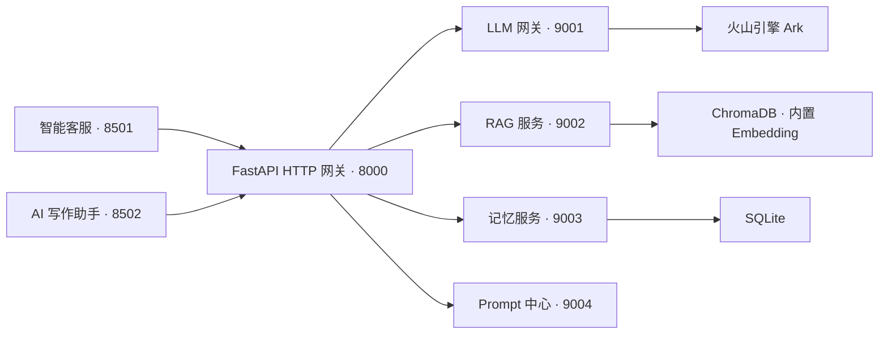

# Agent 集群架构与部署

本仓库包含多项目共享 MCP 服务的本地演示，以及 Docker、Kubernetes 和云端部署的学习资料。演示以**智能客服**和 **AI 写作助手**为例，展示两个业务应用如何通过同一个 HTTP 网关复用模型调用、知识检索、会话记忆和 Prompt 模板。

## 示例架构



业务端通过 HTTP 访问 FastAPI 网关，网关通过 MCP Streamable HTTP 调用共享服务。网关按项目 API Key 识别调用方，记录 Trace ID，并在进程内统计已上报的模型 Token 用量、检查每日配额。

| 共享服务 | 示例中的职责 |
| --- | --- |
| LLM 网关 | 封装 Ark 对话生成和文本向量化 |
| RAG 服务 | 文档分块、向量入库和语义检索，使用 ChromaDB 自带的向量化模型，并按项目建立独立集合 |
| 记忆服务 | 用 SQLite 保存对话记录和用户画像，对话记录按项目和会话区分 |
| Prompt 中心 | 从 JSON 加载客服和写作模板，按请求参数渲染 |

MCP 示例采用单机多进程运行。仓库中的 Docker、Kubernetes 和 CI/CD 内容属于配套学习资料，包含独立的 FastAPI 容器化与部署示例。

## 快速开始

准备 Git 和 [uv](https://docs.astral.sh/uv/getting-started/installation/)。项目声明支持 Python 3.11 及以上，`.python-version` 默认选用 3.13。

```sh
git clone https://github.com/NeoSongNB/Project4_Agent_Cluster_Architecture_and_Deployment.git
cd Project4_Agent_Cluster_Architecture_and_Deployment/预习资料/mcp-demo
uv sync --locked
```

### 验证 MCP 连通性

此步骤无需配置模型密钥。先在当前终端启动示例服务，再在另一个终端进入同一目录运行测试客户端。

```sh
# 终端 1
uv run scripts/hello_server.py

# 终端 2
uv run scripts/test_hello.py
```

客户端会连接 `http://127.0.0.1:9000/mcp`，列出并调用 `hello` 和 `add` 工具。`add` 返回 `42` 后，可用 `Ctrl+C` 停止示例服务。

如果本机配置了 HTTP 代理且访问本地服务时出现 `502`，请将 `127.0.0.1,localhost` 加入 `NO_PROXY`，保留原有条目。

### 运行智能客服和写作助手

1. 将 [`.env.example`](预习资料/mcp-demo/.env.example) 复制为 `.env`。在 PowerShell 中运行 `Copy-Item .env.example .env`，在 Bash 中运行 `cp .env.example .env`。
2. 编辑 `.env`，设置 `ARK_API_KEY`、`ARK_BASE_URL`、`ARK_CHAT_MODEL` 和 `ARK_EMBEDDING_MODEL`。默认 API 地址为 `https://ark.cn-beijing.volces.com/api/v3`。请按账号权限配置对话和向量化模型标识，妥善保存本地密钥。体验对话会调用 Ark，可能产生费用。[火山引擎 Ark 控制台](https://console.volcengine.com/ark)
3. 从 `mcp-demo` 目录启动共享服务、HTTP 网关和两个 Web 应用。使用 `--no-kill` 避免脚本自动终止占用端口的其他进程。

   ```sh
   uv run scripts/start_all_services.py --no-kill
   ```

4. 保持启动终端运行，在另一个终端进入 `mcp-demo` 目录，检查网关并导入演示知识库。健康接口返回下游服务状态，确认 RAG 服务状态为 `ok` 后再执行导入。

   ```sh
   curl.exe http://127.0.0.1:8000/api/health
   uv run scripts/init_knowledge.py
   ```

   macOS 和 Linux 使用 `curl`。导入脚本将产品资料和写作素材写入各自项目的知识库。ChromaDB 首次向量化时可能需要联网下载默认模型。

5. 打开智能客服询问产品功能，或在写作助手中选择文风、输入写作主题。网关响应中的 `X-Trace-ID` 可用于关联终端日志。

| 本地入口 | 地址 |
| --- | --- |
| 智能客服 | [127.0.0.1:8501](http://127.0.0.1:8501/) |
| AI 写作助手 | [127.0.0.1:8502](http://127.0.0.1:8502/) |
| HTTP 网关 API 文档 | [127.0.0.1:8000/docs](http://127.0.0.1:8000/docs) |

只需启动共享服务和网关时，可运行 `uv run scripts/start_all.py`。逐个启动服务、运行 CLI 版业务示例与排查问题的步骤见 [MCP 启动指南](预习资料/mcp-demo/STARTUP.md)。

## 代码与学习资料

| 路径 | 内容 |
| --- | --- |
| [预习资料/demo](预习资料/demo) | 独立的 MCP 客户端与服务端入门示例 |
| [预习资料/mcp-demo](预习资料/mcp-demo) | 完整演示，包含 `shared/` 共享服务、`gateway/` HTTP 网关、`projects/` 业务应用和 `scripts/` 启动与测试脚本 |
| [预习资料/chapters](预习资料/chapters) | 从 MCP 基础、共享服务设计到认证、可观测性、成本和高可用的学习章节 |
| [系统架构体系/docker入门](系统架构体系/docker入门/README.md) | 镜像、容器、Compose 与 FastAPI 镜像构建示例 |
| [系统架构体系/k8s入门](系统架构体系/k8s入门/README.md) | Kubernetes 核心概念、声明式管理和云托管 Kubernetes |
| [系统架构体系/项目到底如何部署？](系统架构体系/项目到底如何部署%EF%BC%9F/README.md) | CI/CD、OSS 与 CDN、Serverless、托管数据库、域名和 HTTPS，附部署示例 |

阅读代码时，可以从 [HTTP 网关路由](预习资料/mcp-demo/gateway/router.py) 沿着工具转发追踪到 [MCP 客户端管理器](预习资料/mcp-demo/gateway/mcp_client_manager.py)，再对照 [智能客服 Agent](预习资料/mcp-demo/projects/customer_service/agent.py) 查看一次业务请求如何读取会话、检索知识、渲染 Prompt 和生成回答。
